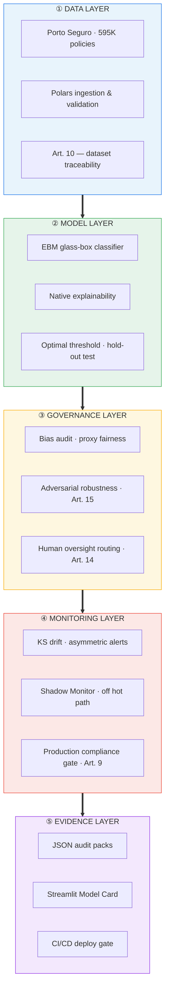
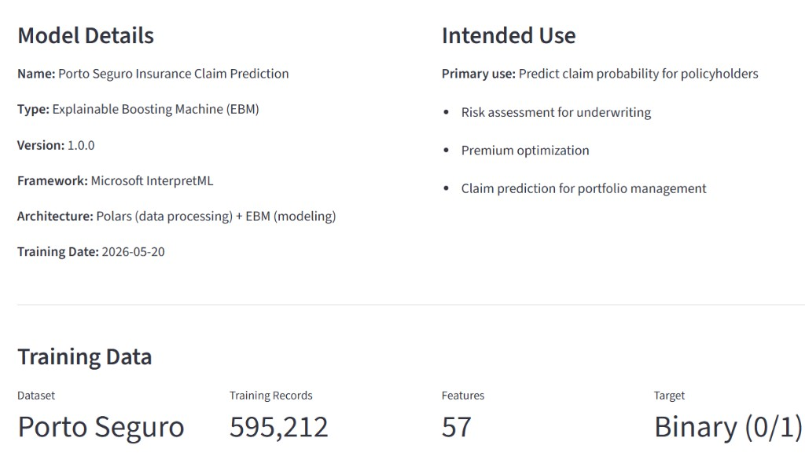
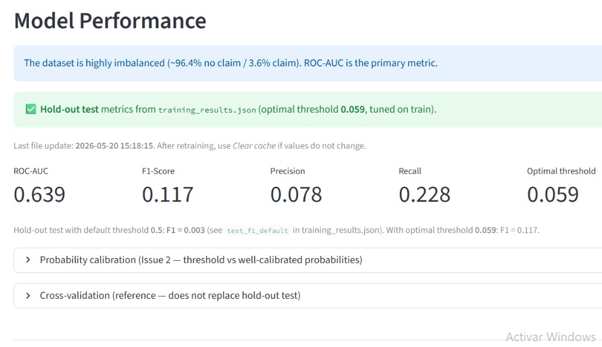
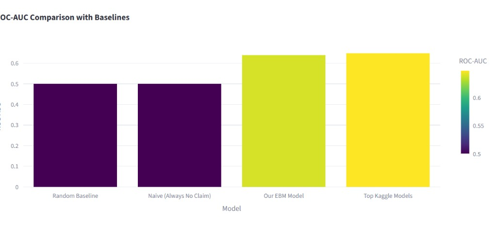
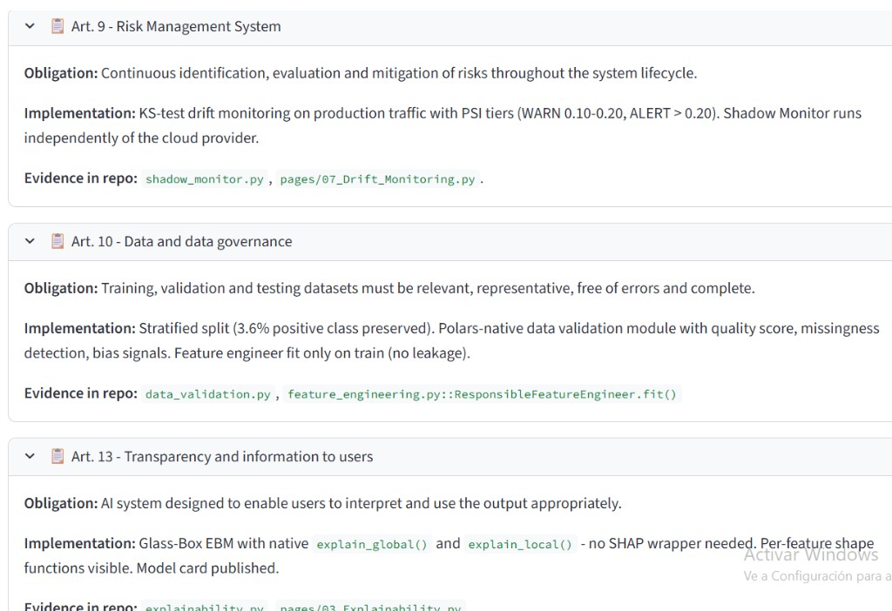
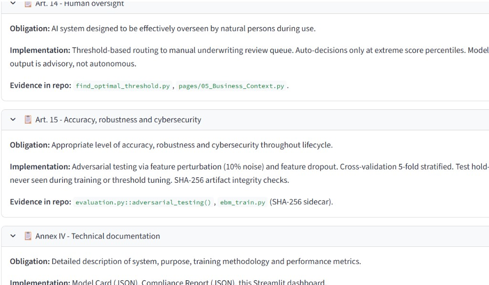
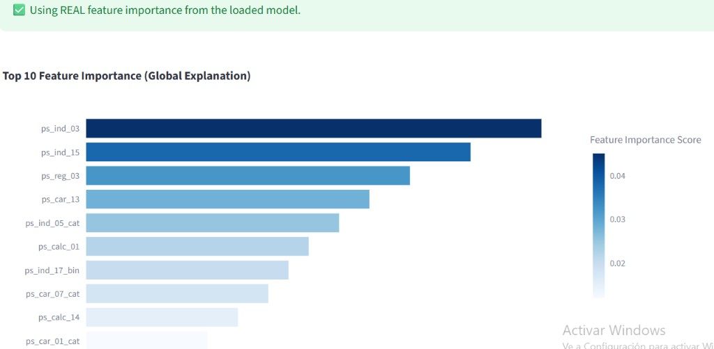
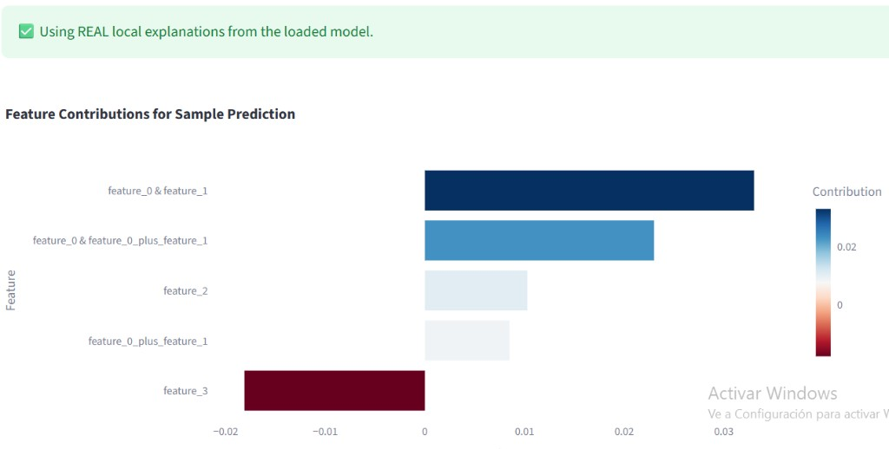
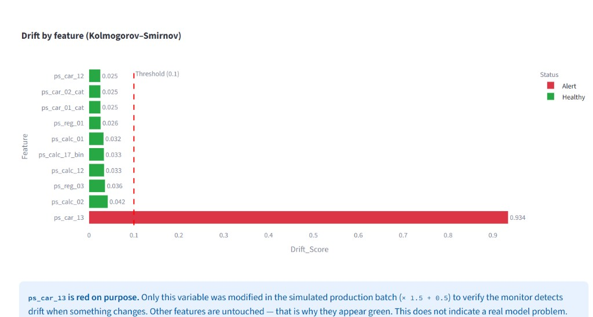
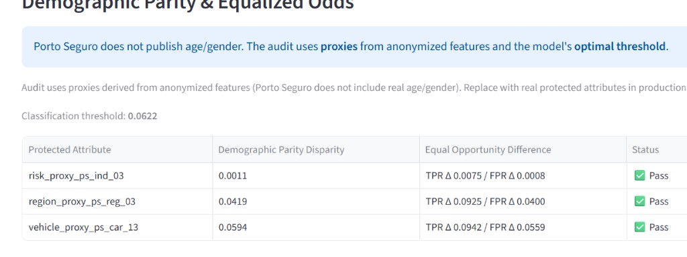

# Porto Seguro — Responsible AI Compliance Hub

> **Production-oriented Responsible AI vendor-agnostic reference architecture** for highly regulated industries. Designed to support technical due diligence and AI governance assessments under the **EU AI Act** and **Solvency II** frameworks.  
> **Not** an AEPD filing, GDPR certification, or EU AI Act conformity decision. Hold-out metrics alone do not prove regulatory compliance.

## Executive Architecture

Single-stack view for C-suite, compliance, and risk committees — five layers, one audit trail (demo evidence packs + in-process control plane).



| Layer | Business question | Regulatory anchor |
|-------|-------------------|-------------------|
| **Data** | Is the training data complete, representative, and leakage-free? | EU AI Act **Art. 10** |
| **Model** | Can we explain every prediction to an underwriter or auditor? | EU AI Act **Art. 13** |
| **Governance** | Is the model fair, robust, and subject to human review? | **Art. 14** · **Art. 15** |
| **Monitoring** | Do we detect drift before it harms the portfolio? | EU AI Act **Art. 9** |
| **Evidence** | Can we show technical evidence to reviewers and Solvency II stakeholders? | **Annex IV** · Solvency II (evidence ≠ certification) |

### What runs locally vs what is demo-only

| Surface | Command / path | Demo vs readiness |
|---------|----------------|-------------------|
| **Streamlit Model Card** | `streamlit run app.py` → `:8501` | Starts on a clean clone **without** `train.csv` / `.pkl` |
| **DPIA / EIPD page** | Sidebar **DPIA GDPR** | Static pack `gdpr_dpia_v1.json` + optional workspace under `src/governance/dpia_workspace/` (assessments **not** published) |
| **Inference API** | `python api_server.py` → `:8000` | `/predict` & `/batch_predict` wrapped by `execute_guarded` **in-process**; needs local artifacts for healthy inference |
| **ML pipeline** | `run_training.py` / `run_training_full.py` | Polars → feature engineering → EBM → explainability → monitoring; needs Kaggle `train.csv` locally |
| **CI governance job** | `.github/workflows/ci.yml` | Governance + evidence-schema + synthetic robustness; optional ML suite `continue-on-error` |

### Control plane limits (honest scope)

- **Single-process** singleton (`src/control_plane/`) — stop / approvals / circuit breaker do **not** replicate across workers.
- Audit JSONL is append-only + hash-chained + local checkpoint sidecar (+ optional `AUDIT_HMAC_KEY`) — **not WORM / not KMS** (dual-rewrite of JSONL + checkpoint defeats local check).
- Reviewer / requester strings are **not SSO** / authentication (no OIDC/JWT).
- Unclassified actions → **default-deny**; nested REDACT failures → fail-closed.
- Application calendar (Art. 113 after **2026/1744**): general application **2026-08-02**; Annex III high-risk duties **2027-12-02** — see `src/control_plane/regulatory_library.py` (encoded dates, not a live EUR-Lex fetch).
- **No GDPR / EU AI Act certification** — evidence packs and UI are lab artefacts, not AEPD / notified-body conformity.

### What this still is not

Honest gaps (demo / lab). Pragmatic mitigations raise the bar; they do **not** close production threat models.

1. **Audit integrity ≠ WORM / KMS** — Checkpoint + JSONL (and optional HMAC) are filesystem-rewritable. They detect clumsy tamper, not an attacker with FS access who rewrites both files (and forges HMAC if they know `AUDIT_HMAC_KEY`). Production needs an external append-only / Object Lock store + KMS sign + independent verify. `AUDIT_HMAC_KEY` is a **shared secret**, not KMS.
2. **`approvals.json` is authoritative and mutable** — Audit trail visibility ≠ prevent ticket edit. `ApprovalStore.verify_against_audit()` (+ optional `APPROVAL_AUDIT_STRICT`) detects obvious JSON↔audit desync; it does not make tickets immutable. Production needs Postgres/Redis transactions + append-only audit. `APPROVAL_BACKEND=memory|json` only (`redis`/`postgres` are interface stubs — not implemented).
3. **`STOP_FILE` is an emergency brake, not transactional** — In-flight work may finish after the file appears. Predict: pre-check + post-check; if the file appears mid-flight, result still returns with `interrupted_by_stop=True` and audit `stop_during_execution`. Export-like (external-effect) actions use pre-check only. API `/predict` also pre-checks at the edge.
4. **Worker / replica detection is best-effort** — `WEB_CONCURRENCY` / `UVICORN_WORKERS` / `WORKERS` miss horizontal replicas (1 worker × N containers). Optional `INSTANCE_ID` + `CONTROL_PLANE_LEASE_DIR` FS heartbeats (TTL ~60s); with `CONTROL_PLANE_STRICT` and >1 recent distinct instance IDs → refuse start. Cheap filesystem lease — **not Redis**.
5. **Rate limit is local** — `RATE_LIMIT_BACKEND=memory|disabled`. No shared backend. Prefer disabled + gateway (nginx / Cloudflare / API Gateway / APIM).
6. **API key is static** — No identity, expiry, revocation, or scopes. Optional `APPROVAL_API_KEY` for `/approvals/decide` and `APPROVAL_SEPARATE_ACTORS=true` (reject reviewer==requester) are SoD demos — **still not OIDC**.

### Deployment limits / not multi-worker safe

See **What this still is not** above. Additional IP trust note:

- **TRUST_PROXY / client IP** — `X-Forwarded-For` is spoofable unless the immediate TCP peer is allowlisted via `TRUSTED_PROXY_IPS` / `TRUSTED_PROXY_CIDRS`. If `TRUST_PROXY=true` with an empty allowlist, XFF is **ignored** (fail closed). When the peer is trusted, the **leftmost** XFF hop is used (single reverse-proxy pattern).

### Threat & assurance docs

- [`docs/THREAT_MODEL.md`](docs/THREAT_MODEL.md) — STRIDE + trust boundaries for this stack
- [`docs/ASSURANCE_MODEL.md`](docs/ASSURANCE_MODEL.md) — evidence present ≠ control effective ≠ conformity
- [`docs/governance/DEMO_PLAYBOOK.md`](docs/governance/DEMO_PLAYBOOK.md) — ES (AEPD-facing): sequence + ticket lifecycle + 90‑s DENY/approval/REDACT/audit + 15‑s tamper demo (technical evidence; not certification)
- [`docs/governance/DEMO_PLAYBOOK_EN.md`](docs/governance/DEMO_PLAYBOOK_EN.md) — English mirror of the demo playbook
- Synthetic packs: [`examples/evidence/`](examples/evidence/) + schemas in [`docs/schemas/`](docs/schemas/)

### Threat & Governance Scope

**Threats addressed**

- Data drift
- Model degradation
- Fairness regressions
- Documentation gaps
- Auditability failures
- Human oversight failures

**Out of scope**

- Adversarial prompt injection
- Agentic AI runtime controls
- LLM security threats
- Supply-chain security

### Roadmap to production (P0 — not implemented here)

| Gap | Honest status | Next concrete step |
|-----|---------------|--------------------|
| Shared stop / approvals / circuit breaker | In-process; `STOP_FILE` + optional FS lease | Redis (or equivalent) shared state + sticky docs |
| API auth | Static `API_KEY` / optional `APPROVAL_API_KEY` | OIDC/JWT with IdP; drop UI role spoofing |
| Immutable audit | JSONL + checkpoint + optional HMAC (not KMS) | S3 Object Lock / WORM + KMS + independent verify |
| Approval authority | Mutable JSON + audit desync check | Postgres/Redis transactions + append-only audit |
| Multi-replica rate limit | In-memory demo limiter | Gateway rate limit; no Redis backend here |
| Evidence vs effectiveness | Fields + assurance docs shipped | Operational owners + scheduled control tests |

---



---

## Endpoints

| Service | Command | URL |
|---------|---------|-----|
| **Model Card Dashboard** | `streamlit run app.py` | `http://localhost:8501` |
| **DPIA / EIPD (GDPR Art. 35)** | sidebar **DPIA GDPR** | `http://localhost:8501` |
| **Inference API Gateway** | `python api_server.py` | `http://localhost:8000` |
| **Compliance Monitor** | `POST /compliance/monitor` | `http://localhost:8000/compliance/monitor` |

---

## Reference Metrics (Hold-Out Test)



| Metric | Value | Note |
|--------|-------|------|
| **ROC-AUC** | 0.639 | Realistic Kaggle benchmark for highly imbalanced fraud/claim data. |
| **F1 @ Optimal Threshold** | **0.117** | Optimized at `0.059` vs. `0.003` at default threshold `0.5`. |
| **Precision** | 0.078 | Expected profile for imbalanced classes — ROC-AUC remains primary metric. |
| **Recall** | 0.228 | Tuned specifically for claim detection at a low-risk threshold. |
| **Accuracy** | ~87% | **Misleading** on imbalanced data — see the Business Context tab. |

These metrics are **technical performance evidence**. They are not a GDPR, AEPD, or AI Act conformity finding.

### Baseline Comparison Context



| Model | ROC-AUC |
|-------|---------|
| Random baseline | 0.50 |
| Naive (always no claim) | 0.50 |
| **Our EBM model** | **0.64** |
| Top Kaggle models | ~0.65 |

> ⚠️ **Production Safeguard:** Do not use `sample_size=10000` for production metrics validation. See detailed protocols in `docs/METRIC_VALIDATION.md` when present locally.

---

## JSON Evidence for Auditors

The architecture materializes audit logs into evidence packs for the dashboard. Status fields use **technical evidence** language (`not_a_conformity_decision` / evidence present) — not a legal “Compliant” stamp.




| File | Content |
|------|---------|
| `docs/compliance_report.json` | Unified EU AI Act + Solvency II report (local / generated) |
| `docs/audit_results.json` | Per-pillar technical evidence status (local / generated) |
| `docs/drift_monitoring_latest.json` | Latest data drift gate check (Art. 9) |
| `docs/robustness_results.json` | Adversarial red teaming and noise tests (Art. 15) |
| `eu_ai_act_conformity_v1.json` | Exportable evidence pack (demo; **not** a completed Art. 43 procedure); `schema_version` + assurance fields |
| `gdpr_dpia_v1.json` | GDPR Art. 35 DPIA / EIPD pack (AEPD innovation-lab walkthrough; not a supervisory filing) |
| `examples/evidence/*_synthetic.json` | Minimal synthetic packs (no Kaggle CSV); schema-validated in CI |
| `training_results.json` | Hold-out metrics + optimal threshold parameters (local) |
| `monitoring/performance_history.json` | Production ROC-AUC historical logs (local) |

**EIPD static pack vs workspace:** `gdpr_dpia_v1.json` is the published demo pack. Editable assessments live under `src/governance/dpia_workspace/` with files in `docs/governance/assessments/` (gitignored). Residual scores in the static pack are **estimated pending verification**.

---

## Why This Stack for Insurance & Life Sciences

### 1. Explainable Boosting Machines (EBM)

Native glass-box explainability via Microsoft InterpretML — no production dependency on unstable SHAP/LIME wrappers.

* **Global Interpretability:** Feature importance across the population.

  

* **Local Interpretability:** Per-prediction feature contributions for case review.

  

### 2. High-Performance Data Processing (Polars)

Processes the 595K-row training set with headroom for larger production volumes without rewriting the pipeline shape.

### 3. Asymmetric Drift Guardrails

Kolmogorov–Smirnov gates isolate structural shifts from harmless variance.



| Feature | Drift score | Status |
|---------|-------------|--------|
| `ps_car_12` … `ps_calc_02` | 0.025 – 0.042 | Healthy |
| **`ps_car_13`** (simulated shift) | **0.934** | **Alert** |

### 4. Privacy-by-Design Fairness Optimization

Proxy-based bias audits when sensitive demographics cannot be collected under privacy rules. Demo dataset ≠ Recital 26 determination.



| Protected attribute (proxy) | Demographic parity disparity | Equal opportunity | Status |
|-----------------------------|------------------------------|-------------------|--------|
| `risk_proxy_ps_ind_03` | 0.0011 | TPR Δ 0.0075 / FPR Δ 0.0008 | Pass |
| `region_proxy_ps_reg_03` | 0.0419 | TPR Δ 0.0925 / FPR Δ 0.0400 | Pass |
| `vehicle_proxy_ps_car_13` | 0.0594 | TPR Δ 0.0942 / FPR Δ 0.0559 | Pass |

---

## Project Structure

```
porto-seguro/
├── app.py                          # Streamlit Model Card entrypoint
├── api_server.py                   # FastAPI + execute_guarded predict
├── run_training.py                 # MLOps pipeline (needs train.csv)
├── run_training_full.py / quick    # Full / quick training variants
├── run_production_monitor.py       # Recurring Art. 9 monitor
├── eu_ai_act_conformity_v1.json    # Demo evidence pack (not Art. 43)
├── gdpr_dpia_v1.json               # GDPR Art. 35 DPIA / EIPD demo pack
├── src/
│   ├── data_processing/            # Polars: load, FE, validation
│   ├── models/                     # EBM, evaluation, explainability
│   ├── governance/                 # Bias audit, EIPD workspace, reporting
│   ├── control_plane/              # Policies, approvals, runtime adapter
│   └── monitoring/                 # Drift, production gate, tracker
├── pages/                          # Overview, Performance, Compliance, DPIA…
├── tests/                          # Governance CI + optional ML unit tests
└── models/artifacts/               # Model, FE, threshold, SHA-256 (gitignored)
```

**ML path:** Polars load/validate → `ResponsibleFeatureEngineer` → EBM train/threshold → native explainability → API `predict_proba_ebm` → optional drift / production gate.

---

## Line report (bottom-up)

Operator facts first: [`docs/governance/LINE_REPORT.md`](docs/governance/LINE_REPORT.md).  
Demo playbook (Mermaid + scripts): [`docs/governance/DEMO_PLAYBOOK.md`](docs/governance/DEMO_PLAYBOOK.md) (ES) · [`DEMO_PLAYBOOK_EN.md`](docs/governance/DEMO_PLAYBOOK_EN.md) (EN).

```bash
pip install -r requirements_streamlit.txt -r requirements_api.txt
pip install pytest pandas numpy jsonschema scikit-learn
python -m pytest tests/test_dpia_workspace.py tests/test_control_plane.py tests/test_import_surface.py tests/test_evidence_schemas.py -q
python -m pytest tests/test_synthetic_robustness.py -q
streamlit run app.py
```

A clean clone starts the Model Card, DPIA and EU AI Act pages without `train.csv` or `.pkl` artifacts (gitignored). Full training still needs the Kaggle file locally. `/predict` is wrapped by `execute_guarded` **in-process only**.

Optional ML suite (needs `pip install -r requirements.txt` / interpret + polars):

```bash
python -m pytest tests/test_data_processing.py tests/test_feature_engineering.py tests/test_proper_pipeline.py tests/test_governance.py -q
# EBM / explainability tests skip automatically if interpret is missing
```

Static EIPD residual scores are **estimated pending verification**. No AEPD / GDPR / AI Act certification is claimed.

---

## Quick Start

```bash
pip install -r requirements.txt
pip install -r requirements_streamlit.txt
pip install -r requirements_api.txt

# Place train.csv (Kaggle Porto Seguro) in project root
python run_training.py
python run_production_monitor.py --refresh-audit
streamlit run app.py
# optional API (artifacts required for healthy /predict)
python api_server.py
```

> **GitHub clone:** `train.csv`, model `.pkl` files, and generated local JSON reports are gitignored. After cloning, add the dataset and run the pipeline above for full ML evidence.

---

## References

- [Porto Seguro — Kaggle](https://www.kaggle.com/c/porto-seguro-safe-driver-prediction)
- [Microsoft InterpretML / EBM](https://github.com/interpretml/interpret)
- [EU AI Act — High-risk AI systems](https://artificialintelligenceact.eu/)
- [Polars](https://pola-rs.github.io/polars/)

---

## Let's Talk

This project is a **production-oriented Responsible AI reference architecture** for regulated industries — designed to support technical due diligence and AI governance assessments from compliance, actuarial, and cybersecurity stakeholders.

- **Demo:** `streamlit run app.py` — walk through the Compliance Hub live
- **Evidence pack:** `eu_ai_act_conformity_v1.json` (technical evidence; not a conformity certificate)
- **Contact:** [Andrés Lage Freire on LinkedIn](https://www.linkedin.com/in/andres-lage-freire-4562a91b1) · open an issue in this repository

---

*Responsible AI demonstration project · EU AI Act & Solvency II evidence mapping · Polars + EBM architecture · no certification claimed*
