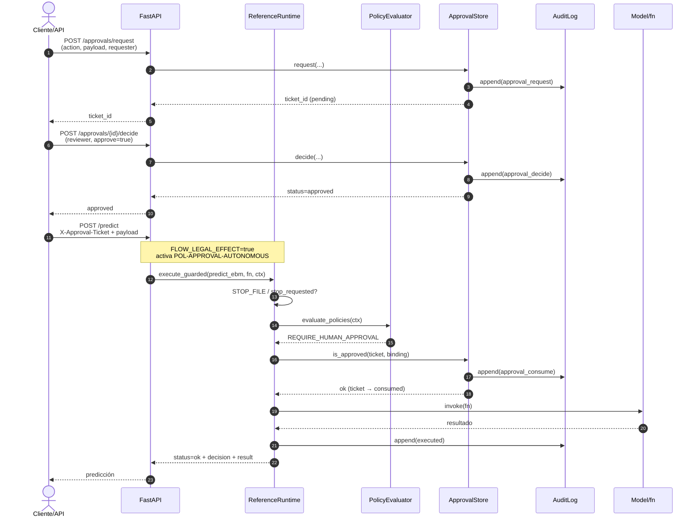
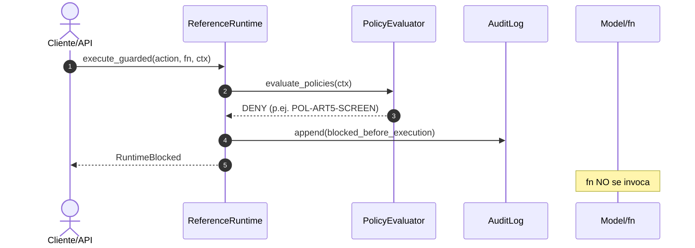
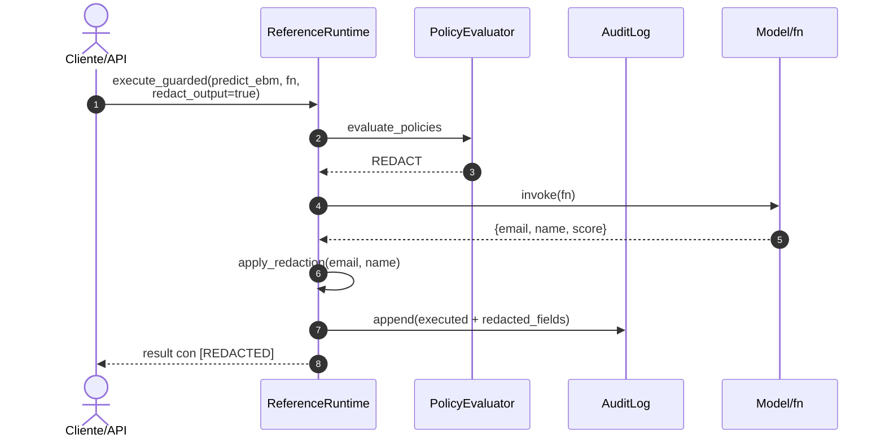

# Playbook de demo — control plane (laboratorio)

**Audiencia:** revisión técnica / evidencia demostrable (p. ej. AEPD u otros stakeholders).  
**No es** certificación AEPD, RGPD ni Reglamento de IA. Lenguaje de evidencia técnica y demo.

**Ámbito honesto (código actual):**

- Enforcement solo en acciones que pasan por `ReferenceRuntime.execute_guarded` **en este proceso**.
- `get_runtime()` es singleton **por proceso**; con varios workers de uvicorn stop / approvals / circuit **no** se comparten. Preferir `uvicorn --workers 1`.
- `STOP_FILE` (env): freno de emergencia por fichero (`Path.exists()`), no transaccional.
- Tickets en `ApprovalStore` → JSON reescribible (`docs/governance/approvals.json`); requester/reviewer son strings de demo (**no** SSO).
- `AuditLog` → JSONL append-only + cadena de hashes + checkpoint local (**no** WORM).
- Redis / OIDC / Object Lock **no** están implementados como runtime en vivo.

Políticas por defecto: `src/control_plane/default_policies.py` (`POL-ART5-SCREEN`, `POL-EXPORT-PII`, `POL-APPROVAL-AUTONOMOUS`, `POL-REDACT-OUTPUT`, …).

---

## 1. Diagrama de secuencia — decisión gobernada

Flujo real de `execute_guarded` (`src/control_plane/runtime.py`): evaluación → DENY/STOP/aprobación → invocación de `fn` → REDACT opcional → `audit.append`.

### 1.1 Camino feliz: `REQUIRE_HUMAN_APPROVAL` + ticket



### 1.2 Camino DENY (antes de ejecutar `fn`)

Ejemplos en código: `art5_concern=true` → `POL-ART5-SCREEN` (prioridad 5).  
`export_external` sin tool en allowlist → suele disparar antes `POL-DENY-TOOL` (prioridad 10; las acciones externas marcan `tool_allowed=False`).  
`export_external` + tool allowlisted (p. ej. `predict_ebm`) + `identifiable_personal_data=true` → `POL-EXPORT-PII` (prioridad 15). En ambos casos **DENY antes de `fn`**.



### 1.3 REDACT en salida + append de auditoría

`POL-REDACT-OUTPUT` cuando `redact_output=true`. Campos por defecto: `email`, `name` → `[REDACTED]`. Fallo de redacción → fail-closed DENY. Acciones de efecto externo **no** se “arreglan” con REDACT post-hoc (se bloquean).



**Cadena de hash (AuditLog):**  
`event_hash_n = SHA256(canonical(event_n) + previous_event_hash)`; genesis = 64 ceros. Verificar con `AuditLog.verify_chain()` y opcionalmente `verify_checkpoint()`. Dual-rewrite de JSONL + checkpoint derrota la comprobación local — **no** es WORM.

---

## 2. Caso de uso de 2 minutos — incidente y respuesta

**Escenario de laboratorio:** demo de claim scoring Porto Seguro. Un operador intenta **exportar** un lote con datos personales identificables a un proveedor externo no listado, o marca un flujo con `art5_concern` (screening, no hallazgo judicial).

| Tiempo | Qué ocurre | Evidencia en código |
|--------|------------|---------------------|
| 0:00–0:20 | Intento A: `art5_concern=true` → `POL-ART5-SCREEN`. Intento B: export+PII (ver nota de prioridades arriba) | DENY pre-ejecución |
| 0:20–0:40 | `execute_guarded` → **DENY** *antes* de `fn`; `action_taken=blocked_before_execution` | `RuntimeBlocked` |
| 0:40–1:10 | Revisión: leer cola de auditoría; opcional `request_stop` o crear `STOP_FILE` | `AuditLog` / `STOP_FILE` |
| 1:10–1:40 | Si el caso es scoring con efecto jurídico (no export): ticket `request` → `decide` → reintento con binding | `ApprovalStore` |
| 1:40–2:00 | Confirmar: export/art5 sigue DENY; scoring solo con ticket válido de un solo uso | JSON tickets + JSONL |

### Script mínimo (sin artefactos ML)

```python
from pathlib import Path
from src.control_plane.approvals import ApprovalStore
from src.control_plane.audit import AuditLog
from src.control_plane.runtime import ReferenceRuntime, RuntimeBlocked

audit = AuditLog(Path("docs/governance/_demo_incident_audit.jsonl"))
rt = ReferenceRuntime(approvals=ApprovalStore(audit=audit), audit=audit)

# 1) Incidente A: screening Art. 5 → POL-ART5-SCREEN (fn no corre)
try:
    rt.execute_guarded("predict_ebm", lambda: 1, {"art5_concern": True, "tool": "predict_ebm"})
except RuntimeBlocked as exc:
    print("DENY art5:", exc.decision.get("policy_id"), exc.decision.get("effect"))

# 2) Incidente B: export + PII → POL-EXPORT-PII (tool allowlisted evita POL-DENY-TOOL primero)
try:
    rt.execute_guarded(
        "export_external",
        lambda: "SENT_TO_VENDOR",  # no debe ejecutarse
        {"identifiable_personal_data": True, "tool": "predict_ebm"},
    )
except RuntimeBlocked as exc:
    print("DENY export:", exc.decision.get("policy_id"), exc.decision.get("effect"))

# 3) Respuesta opcional: stop de emergencia en este proceso
rt.request_stop(reason="incident_export_pii", actor="ops-demo")

# 4) Flujo de ticket solo para scoring con legal_effect (no desbloquea export_external)
payload = {"case": "claim_review_lab"}
ticket = rt.approvals.request(
    action="score", requester="ops-demo", reason="HITL tras incidente", payload=payload
)
rt.approvals.decide(ticket["ticket_id"], reviewer="risk-reviewer", approve=True, rationale="revisado")
rt.clear_stop(actor="ops-demo")
out = rt.execute_guarded(
    "score",
    lambda: {"score": 0.42},
    {
        "legal_effect_decision": True,
        "approval_ticket_id": ticket["ticket_id"],
        "approval_payload": payload,
    },
)
print("score ok:", out["status"], "policy:", out["decision"].get("effect"))
ok, msg = audit.verify_chain()
print("audit chain:", ok, msg)
```

**Límite realista:** el stop es por proceso (o `STOP_FILE` compartido entre workers del mismo host). No hay Redis de estado compartido en este build.

---

## 3. Demo de 90 segundos — DENY, aprobación, redacción, auditoría

Ejecutar desde la raíz del repo. **Preferido:** Python solo control plane (funciona sin pickles). API opcional al final si hay modelo local.

### Reloj (beats)

| Segundos | Beat | Qué mostrar |
|----------|------|-------------|
| **0–15** | DENY | `art5_concern` o `export_external`+PII → `RuntimeBlocked`; `fn` no corre |
| **15–45** | Aprobación | `request` → `decide` → `execute_guarded` con ticket + binding |
| **45–70** | Redacción | `redact_output=true` → `email`/`name` = `[REDACTED]` |
| **70–90** | Auditoría | `verify_chain()` + últimas filas del JSONL (hashes encadenados) |

### Script único (control plane, sin modelo)

```python
from pathlib import Path
from src.control_plane.approvals import ApprovalStore
from src.control_plane.audit import AuditLog
from src.control_plane.runtime import ReferenceRuntime, RuntimeBlocked

audit_path = Path("docs/governance/_demo_90s_audit.jsonl")
if audit_path.exists():
    audit_path.unlink()
cp = audit_path.with_suffix(audit_path.suffix + ".checkpoint.json")
if cp.exists():
    cp.unlink()

audit = AuditLog(audit_path)
rt = ReferenceRuntime(approvals=ApprovalStore(audit=audit), audit=audit)

# --- 0–15s DENY (POL-ART5-SCREEN; fn no se invoca) ---
try:
    rt.execute_guarded(
        "predict_ebm",
        lambda: "SHOULD_NOT_RUN",
        {"art5_concern": True, "tool": "predict_ebm"},
    )
except RuntimeBlocked as e:
    print("[DENY]", e.decision["policy_id"], e.decision["effect"])

# --- 15–45s APPROVAL ---
payload = {"case": "porto_lab_score"}
t = rt.approvals.request(
    action="score", requester="demo-req", reason="legal_effect lab", payload=payload
)
print("[TICKET]", t["ticket_id"], t["status"])
rt.approvals.decide(t["ticket_id"], reviewer="demo-rev", approve=True, rationale="HITL ok")
out = rt.execute_guarded(
    "score",
    lambda: {"score": 0.31, "email": "a@b.c", "name": "Ada"},
    {
        "legal_effect_decision": True,
        "approval_ticket_id": t["ticket_id"],
        "approval_payload": payload,
    },
)
print("[APPROVED RUN]", out["status"], out["decision"]["effect"], out["result"])

# --- 45–70s REDACT ---
red = rt.execute_guarded(
    "predict_ebm",
    lambda: {"email": "a@b.c", "name": "Ada", "score": 0.31},
    {"tool": "predict_ebm", "record_count": 1, "redact_output": True},
)
print("[REDACT]", red["result"], "fields:", red["context"].get("redacted_fields"))

# --- 70–90s AUDIT ---
ok, msg = audit.verify_chain()
rows = audit.read_all()
print("[AUDIT]", "verify_chain=", ok, msg, "events=", len(rows))
for row in rows[-4:]:
    print(
        " ",
        row.get("rule_triggered") or row.get("action_taken"),
        row.get("decision"),
        "hash=",
        (row.get("event_hash") or "")[:12],
        "prev=",
        (row.get("previous_event_hash") or "")[:12],
    )
```

### API local (opcional; necesita artefactos + workers=1)

```powershell
# Terminal 1 — un solo proceso
$env:FLOW_LEGAL_EFFECT = "true"
# opcional: $env:STOP_FILE = "docs/governance/_STOP"
python api_server.py
```

```powershell
# 1) Pedir y aprobar ticket (payload debe coincidir con features de /predict)
$req = Invoke-RestMethod -Method POST -Uri http://127.0.0.1:8000/approvals/request `
  -ContentType "application/json" `
  -Body '{"action":"predict_ebm","tool":"predict_ebm","requester":"demo-req","reason":"HITL","payload":{"ps_ind_01":0}}'
Invoke-RestMethod -Method POST -Uri "http://127.0.0.1:8000/approvals/$($req.ticket_id)/decide" `
  -ContentType "application/json" `
  -Body '{"reviewer":"demo-rev","approve":true,"rationale":"ok"}'

# 2) Predecir con cabecera de ticket (503 si no hay modelo)
curl.exe -s -X POST http://127.0.0.1:8000/predict `
  -H "Content-Type: application/json" `
  -H "X-Approval-Ticket: $($req.ticket_id)" `
  -d '{"features":{"ps_ind_01":0}}'
```

**Notas API:** sin `.pkl` local, `/health` → unhealthy y `/predict` → 503. `/audit/summary` lee `logs/prediction_audit.jsonl` (auditoría de predicciones HTTP), **distinta** del JSONL del control plane (`docs/governance/control_plane_audit.jsonl`). Para la demo de cadena de hashes, usar el script Python de arriba.

### Checklist de límites a verbalizar (15 s)

1. Un proceso / `STOP_FILE` opcional — no Redis.  
2. Approvals = JSON mutable + strings — no SSO.  
3. Audit = hash chain local — no WORM.  
4. Evidencia técnica demostrable ≠ certificación normativa.
