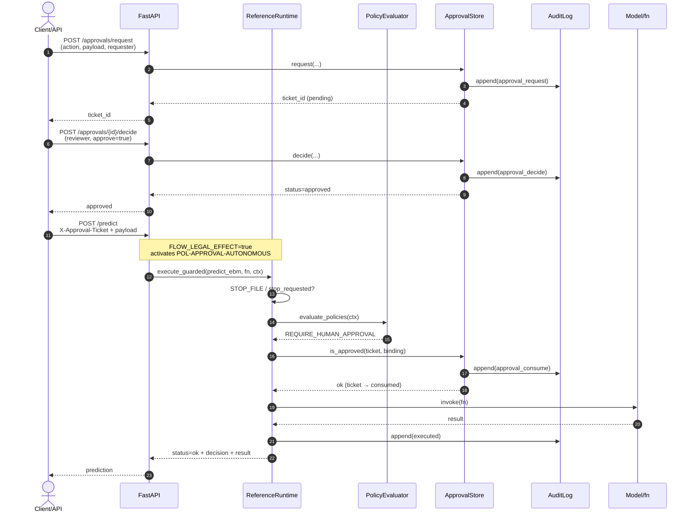
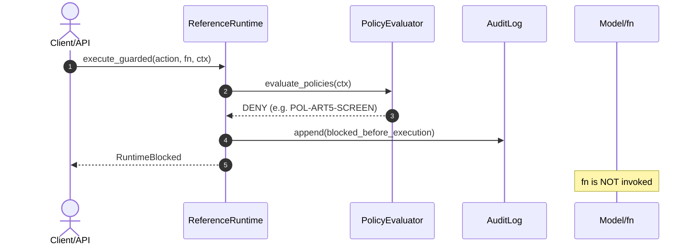
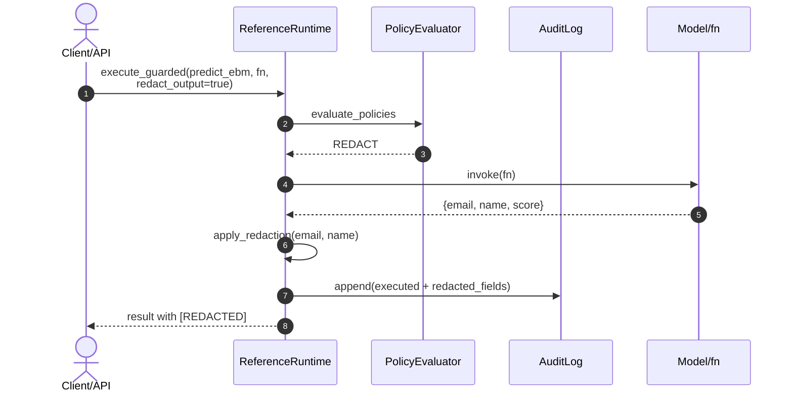
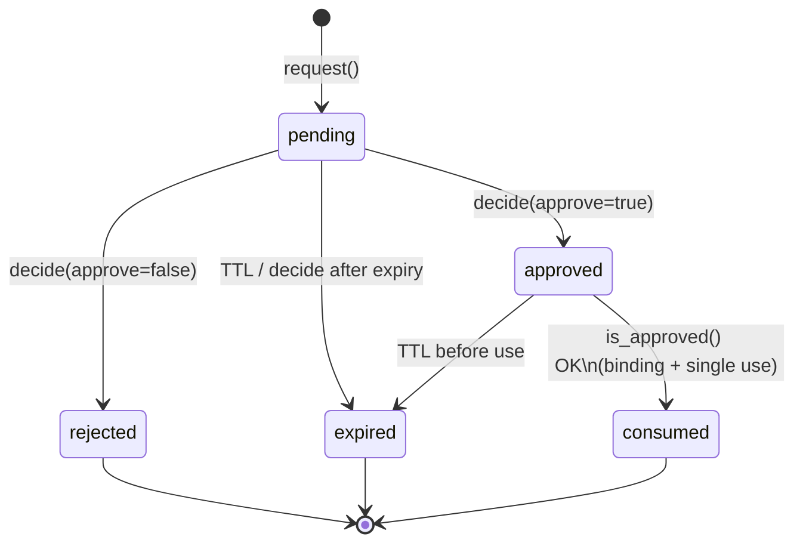

# Demo playbook — control plane (lab)

**Audience:** technical review / demonstrable evidence (e.g. AEPD or other stakeholders).  
**Not** AEPD, GDPR, or EU AI Act certification. Technical evidence and demo language only.

**Español (primary, AEPD-facing):** [`DEMO_PLAYBOOK.md`](DEMO_PLAYBOOK.md).

**Honest scope (current code):**

- Enforcement only for actions that pass through `ReferenceRuntime.execute_guarded` **in this process**.
- `get_runtime()` is a **per-process** singleton; with multiple uvicorn workers, stop / approvals / circuit are **not** shared. Prefer `uvicorn --workers 1`.
- `STOP_FILE` (env): file-based emergency brake (`Path.exists()`), not transactional.
- Tickets in `ApprovalStore` → rewritable JSON (`docs/governance/approvals.json`); requester/reviewer are demo strings (**not** SSO).
- `AuditLog` → append-only JSONL + hash chain + local checkpoint (**not** WORM).
- Redis / OIDC / Object Lock are **not** implemented as live runtime.

Default policies: `src/control_plane/default_policies.py` (`POL-ART5-SCREEN`, `POL-EXPORT-PII`, `POL-APPROVAL-AUTONOMOUS`, `POL-REDACT-OUTPUT`, …).

---

## 0. Two distinct audits (do not confuse in a live demo)

| | **Control-plane audit** | **Prediction audit** |
|---|---|---|
| **What** | Runtime hash chain (`AuditLog`) | HTTP prediction log (`api_server`) |
| **Typical path** | `docs/governance/control_plane_audit.jsonl` (or demo `_demo_*.jsonl`) | `logs/prediction_audit.jsonl` |
| **Writer** | `ReferenceRuntime` / `ApprovalStore` via `AuditLog.append` | `api_server` serving `/predict` |
| **Integrity** | `verify_chain()` + local checkpoint | Prediction queue; **not** the control-plane chain |
| **Endpoint** | Python scripts / file inspection | `/audit/summary` reads the prediction log |

> **Callout — control-plane audit:** local hash chain + checkpoint. Detects clumsy JSONL rewrites. **Not** WORM or KMS.

> **Callout — prediction audit:** HTTP scoring telemetry. Useful for API demos; **does not** replace or verify the control-plane chain.

---

## 1. Sequence diagram — governed decision

Real `execute_guarded` flow (`src/control_plane/runtime.py`): evaluate → DENY/STOP/approval → invoke `fn` → optional REDACT → `audit.append`.

### 1.1 Happy path: `REQUIRE_HUMAN_APPROVAL` + ticket



### 1.2 DENY path (before `fn` runs)

Code examples: `art5_concern=true` → `POL-ART5-SCREEN` (priority 5).  
`export_external` without an allowlisted tool → usually hits `POL-DENY-TOOL` first (priority 10; external actions set `tool_allowed=False`).  
`export_external` + allowlisted tool (e.g. `predict_ebm`) + `identifiable_personal_data=true` → `POL-EXPORT-PII` (priority 15). In both cases **DENY before `fn`**.



### 1.3 Output REDACT + audit append

`POL-REDACT-OUTPUT` when `redact_output=true`. Default fields: `email`, `name` → `[REDACTED]`. Redaction failure → fail-closed DENY. External-effect actions are **not** “fixed” with post-hoc REDACT (they are blocked).



**Hash chain (AuditLog):**  
`event_hash_n = SHA256(canonical(event_n) + previous_event_hash)`; genesis = 64 zeros. Verify with `AuditLog.verify_chain()` and optionally `verify_checkpoint()`. Dual-rewrite of JSONL + checkpoint defeats the local check — **not** WORM.

### 1.4 Ticket lifecycle (`ApprovalStore`)

Real states in `src/control_plane/approvals.py`: `pending` → `approved` | `rejected` | `expired`. After a successful `is_approved` (binding OK), the ticket becomes `consumed` (single-use anti-replay).



**Anti-replay:** an `approved` ticket is marked `consumed` inside `is_approved` on successful consume; a second `execute_guarded` with the same `ticket_id` fails (status ≠ `approved`).

---

## 2. Two-minute use case — incident and response

**Lab scenario:** Porto Seguro claim-scoring demo. An operator tries to **export** a batch with identifiable personal data to an unlisted external vendor, or flags a flow with `art5_concern` (screening, not a judicial finding).

| Time | What happens | Evidence in code |
|------|--------------|------------------|
| 0:00–0:20 | Attempt A: `art5_concern=true` → `POL-ART5-SCREEN`. Attempt B: export+PII (see priority note above) | Pre-execution DENY |
| 0:20–0:40 | `execute_guarded` → **DENY** *before* `fn`; `action_taken=blocked_before_execution` | `RuntimeBlocked` |
| 0:40–1:10 | Review: read audit queue; optional `request_stop` or create `STOP_FILE` | `AuditLog` / `STOP_FILE` |
| 1:10–1:40 | If scoring with legal effect (not export): ticket `request` → `decide` → retry with binding | `ApprovalStore` |
| 1:40–2:00 | Confirm: export/art5 still DENY; scoring only with a valid single-use ticket | Ticket JSON + JSONL |

### Minimal script (no ML artifacts)

```python
from pathlib import Path
from src.control_plane.approvals import ApprovalStore
from src.control_plane.audit import AuditLog
from src.control_plane.runtime import ReferenceRuntime, RuntimeBlocked

audit = AuditLog(Path("docs/governance/_demo_incident_audit.jsonl"))
rt = ReferenceRuntime(approvals=ApprovalStore(audit=audit), audit=audit)

# 1) Incident A: Art. 5 screening → POL-ART5-SCREEN (fn does not run)
try:
    rt.execute_guarded("predict_ebm", lambda: 1, {"art5_concern": True, "tool": "predict_ebm"})
except RuntimeBlocked as exc:
    print("DENY art5:", exc.decision.get("policy_id"), exc.decision.get("effect"))

# 2) Incident B: export + PII → POL-EXPORT-PII (allowlisted tool avoids POL-DENY-TOOL first)
try:
    rt.execute_guarded(
        "export_external",
        lambda: "SENT_TO_VENDOR",  # must not run
        {"identifiable_personal_data": True, "tool": "predict_ebm"},
    )
except RuntimeBlocked as exc:
    print("DENY export:", exc.decision.get("policy_id"), exc.decision.get("effect"))

# 3) Optional response: emergency stop in this process
rt.request_stop(reason="incident_export_pii", actor="ops-demo")

# 4) Ticket flow only for scoring with legal_effect (does not unlock export_external)
payload = {"case": "claim_review_lab"}
ticket = rt.approvals.request(
    action="score", requester="ops-demo", reason="HITL after incident", payload=payload
)
rt.approvals.decide(ticket["ticket_id"], reviewer="risk-reviewer", approve=True, rationale="reviewed")
rt.clear_stop(actor="ops-demo")
out = rt.execute_guarded(
    "score",
    lambda: {"score": 0.42},
    {
        "legal_effect_decision": True,
        "approval_ticket_id": ticket["ticket_id"],
        "approval_payload": payload,
    },
)
print("score ok:", out["status"], "policy:", out["decision"].get("effect"))
ok, msg = audit.verify_chain()
print("audit chain:", ok, msg)
```

**Realistic limit:** stop is per-process (or a `STOP_FILE` shared by workers on the same host). No shared Redis state in this build.

---

## 3. 90-second demo — DENY, approval, redaction, audit

Run from the repo root. **Preferred:** Python control-plane only (works without pickles). Optional API at the end if a local model is present.

### Clock (beats)

| Seconds | Beat | What to show |
|---------|------|--------------|
| **0–15** | DENY | `art5_concern` or `export_external`+PII → `RuntimeBlocked`; `fn` does not run |
| **15–45** | Approval | `request` → `decide` → `execute_guarded` with ticket + binding |
| **45–70** | Redaction | `redact_output=true` → `email`/`name` = `[REDACTED]` |
| **70–90** | Audit | `verify_chain()` + last JSONL rows (chained hashes) |

### Single script (control plane, no model)

```python
from pathlib import Path
from src.control_plane.approvals import ApprovalStore
from src.control_plane.audit import AuditLog
from src.control_plane.runtime import ReferenceRuntime, RuntimeBlocked

audit_path = Path("docs/governance/_demo_90s_audit.jsonl")
if audit_path.exists():
    audit_path.unlink()
cp = audit_path.with_suffix(audit_path.suffix + ".checkpoint.json")
if cp.exists():
    cp.unlink()

audit = AuditLog(audit_path)
rt = ReferenceRuntime(approvals=ApprovalStore(audit=audit), audit=audit)

# --- 0–15s DENY (POL-ART5-SCREEN; fn not invoked) ---
try:
    rt.execute_guarded(
        "predict_ebm",
        lambda: "SHOULD_NOT_RUN",
        {"art5_concern": True, "tool": "predict_ebm"},
    )
except RuntimeBlocked as e:
    print("[DENY]", e.decision["policy_id"], e.decision["effect"])

# --- 15–45s APPROVAL ---
payload = {"case": "porto_lab_score"}
t = rt.approvals.request(
    action="score", requester="demo-req", reason="legal_effect lab", payload=payload
)
print("[TICKET]", t["ticket_id"], t["status"])
rt.approvals.decide(t["ticket_id"], reviewer="demo-rev", approve=True, rationale="HITL ok")
out = rt.execute_guarded(
    "score",
    lambda: {"score": 0.31, "email": "a@b.c", "name": "Ada"},
    {
        "legal_effect_decision": True,
        "approval_ticket_id": t["ticket_id"],
        "approval_payload": payload,
    },
)
print("[APPROVED RUN]", out["status"], out["decision"]["effect"], out["result"])

# --- 45–70s REDACT ---
red = rt.execute_guarded(
    "predict_ebm",
    lambda: {"email": "a@b.c", "name": "Ada", "score": 0.31},
    {"tool": "predict_ebm", "record_count": 1, "redact_output": True},
)
print("[REDACT]", red["result"], "fields:", red["context"].get("redacted_fields"))

# --- 70–90s AUDIT ---
ok, msg = audit.verify_chain()
rows = audit.read_all()
print("[AUDIT]", "verify_chain=", ok, msg, "events=", len(rows))
for row in rows[-4:]:
    print(
        " ",
        row.get("rule_triggered") or row.get("action_taken"),
        row.get("decision"),
        "hash=",
        (row.get("event_hash") or "")[:12],
        "prev=",
        (row.get("previous_event_hash") or "")[:12],
    )
```

### Expected output (success tags)

When the demo succeeds, the console should show lines with these tags (exact `ticket_id` / hashes vary):

```text
[DENY] POL-ART5-SCREEN DENY
[TICKET] APR-... pending
[APPROVED RUN] ok REQUIRE_HUMAN_APPROVAL {'score': 0.31, 'email': 'a@b.c', 'name': 'Ada'}
[REDACT] {'email': '[REDACTED]', 'name': '[REDACTED]', 'score': 0.31} fields: ['email', 'name']
[AUDIT] verify_chain= True ok events= N
```

| Tag | Success means… |
|-----|-----------------|
| `[DENY]` | Policy `POL-ART5-SCREEN` (or other DENY) and `fn` did not run |
| `[TICKET]` | Ticket created in `pending` |
| `[APPROVED RUN]` | `status=ok` with effect `REQUIRE_HUMAN_APPROVAL` after ticket + binding |
| `[REDACT]` | `email`/`name` = `[REDACTED]` |
| `[AUDIT]` | `verify_chain= True` on the **control-plane** JSONL (demo path) |

### Local API (optional; needs artifacts + workers=1)

```powershell
# Terminal 1 — single process
$env:FLOW_LEGAL_EFFECT = "true"
# optional: $env:STOP_FILE = "docs/governance/_STOP"
python api_server.py
```

```powershell
# 1) Request and approve ticket (payload must match /predict features)
$req = Invoke-RestMethod -Method POST -Uri http://127.0.0.1:8000/approvals/request `
  -ContentType "application/json" `
  -Body '{"action":"predict_ebm","tool":"predict_ebm","requester":"demo-req","reason":"HITL","payload":{"ps_ind_01":0}}'
Invoke-RestMethod -Method POST -Uri "http://127.0.0.1:8000/approvals/$($req.ticket_id)/decide" `
  -ContentType "application/json" `
  -Body '{"reviewer":"demo-rev","approve":true,"rationale":"ok"}'

# 2) Predict with ticket header (503 if no model)
curl.exe -s -X POST http://127.0.0.1:8000/predict `
  -H "Content-Type: application/json" `
  -H "X-Approval-Ticket: $($req.ticket_id)" `
  -d '{"features":{"ps_ind_01":0}}'
```

**API notes:** without a local `.pkl`, `/health` → unhealthy and `/predict` → 503. `/audit/summary` reads `logs/prediction_audit.jsonl` (**prediction audit**), **distinct** from the control-plane JSONL (`docs/governance/control_plane_audit.jsonl` or the script `_demo_*` path). For the hash-chain demo, use the Python script above — see [§0](#0-two-distinct-audits-do-not-confuse-in-a-live-demo).

---

## 4. 15 s mini-demo — clumsy audit tampering (control plane)

**Goal:** show that `AuditLog.verify_chain()` detects a clumsy rewrite of one JSONL line.  
**Honesty:** local detection of blunt tampering — **not** WORM, **not** KMS, **not** Object Lock. Anyone with filesystem control can rewrite JSONL **and** checkpoint together and defeat the check.

```python
from pathlib import Path
from src.control_plane.audit import AuditLog

path = Path("docs/governance/_demo_tamper_audit.jsonl")
cp = path.with_suffix(path.suffix + ".checkpoint.json")
for p in (path, cp):
    if p.exists():
        p.unlink()

audit = AuditLog(path)
audit.append({"rule_triggered": "demo_a", "decision": "ALLOW"})
audit.append({"rule_triggered": "demo_b", "decision": "ALLOW"})
ok, msg = audit.verify_chain()
print("[AUDIT] before tamper:", ok, msg)  # True ok

# Rewrite one line (clumsy tamper)
lines = path.read_text(encoding="utf-8").splitlines()
lines[0] = lines[0].replace('"demo_a"', '"demo_TAMPERED"')
path.write_text("\n".join(lines) + "\n", encoding="utf-8")

ok2, msg2 = audit.verify_chain()
print("[AUDIT] after tamper:", ok2, msg2)  # False chain_break_at_…
assert ok and not ok2
```

Expected output:

```text
[AUDIT] before tamper: True ok
[AUDIT] after tamper: False chain_break_at_0
```

---

## 5. Limits checklist to say out loud (15 s)

1. One process / optional `STOP_FILE` — no Redis.  
2. Approvals = mutable JSON + strings — no SSO.  
3. Control-plane audit = local hash chain — not WORM / KMS (detects clumsy tamper).  
4. Prediction audit (`logs/prediction_audit.jsonl`) ≠ control-plane audit.  
5. Demonstrable technical evidence ≠ regulatory certification.
